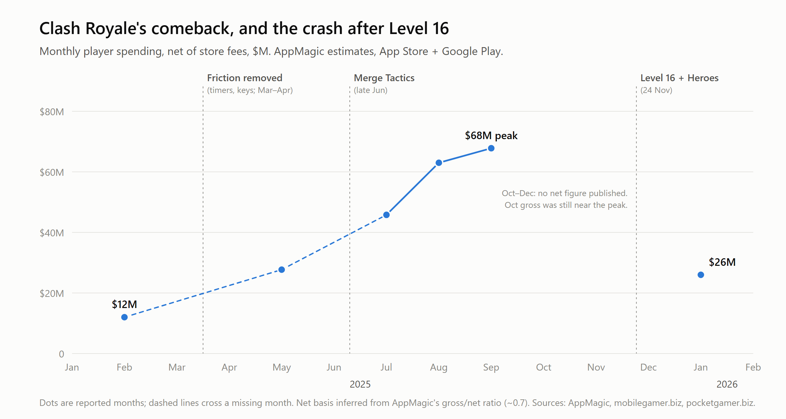
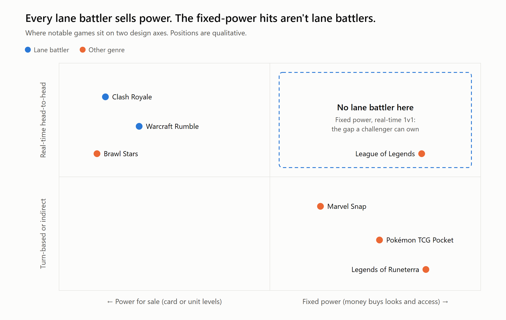

# Why nobody has cracked the lane battler

**The genre:** the real-time PvP lane battler. Two players, eight cards, a regenerating elixir bar, three towers each, three minutes. Clash Royale invented it in 2016, and ten years on it still has no real rival. Blizzard tried with Warcraft Rumble; Supercell tried twice itself, with Clash Mini and Squad Busters. So this is the brief's second case: not a genre nobody has made money in, but one that is overdue for reinvention, because its one hit can't reinvent itself.

**The short answer:** the genre isn't saturated. It's stuck, because its revenue engine is the thing its players hate. Clash Royale sells card levels, each a flat stat boost, and every new level has set off a revolt. Supercell can't remove levels without cutting its own income, and every challenger copied them onto a player base too small to hide the pay-to-win. A breakout needs fixed card power in ranked, a deep money sink that sells identity rather than strength, and a plan for the empty queue every new PvP game hits early on.

## 1. The demand is there

Clash Royale has taken more than $4.9B in player spending [1]. In 2025 its monthly revenue went from about $12M in February to about $68M in September, net of store fees [2], and the year closed at $647M gross, up 149% [1]. Players came back with it: monthly players rose from 52M in June to 75M in December [3], and Supercell reported "a big improvement in returning player retention" [4]. World-finals viewership peaked at 698K, up from 142K a year earlier [5]. The audience is large, and much of it is lapsed rather than gone.

## 2. Why it hasn't worked

### 2a. The power treadmill is the business, and players hate it

Clash Royale's balance rule, as its card designer put it at GDC 2017, is that each level adds 10% to HP and damage "so all interactions remain the same" [6]. That's elegant for balance and brutal for players: a level gap doesn't change how a matchup plays, only who wins it. Losing to a higher-level deck feels like losing to a wallet, because it is.

Look at when the game hurt itself. Level 15 (June 2023), after players had been told 14 was the cap, set off boycotts [7]. Level 16 with paywalled Heroes (November 2025) was worse. In August 2026, Supercell's design lead said it plainly: **"At the end of last year, we killed Clash Royale"** [8]. Monthly revenue fell from about $68M in September to $26M in January, down 62% in four months [2], while monthly players held up: 65M in September, 74M in January [3]. The players stayed; the payers left. The 2025 boom had come from the opposite direction: removing chest timers and keys, letting players choose which cards to upgrade, and handing Evolutions out broadly [2][4].

Even ranked drifted: capped at Level 11 in 2023 [9], Level 16 by 2026 [10]. Supercell's June 2026 promise of no more card levels [8] is as far as it can go, because levels are what the game sells.

### 2b. Challengers copied the treadmill onto smaller ladders

Warcraft Rumble shows the problem isn't weak monetization. Its 30-day revenue per download was $7.55, more than double Marvel Snap's $3.41 [11], yet monthly revenue fell about 92% in its first year [12]. Upgrade costs compounded (1.7–2x per step, per a fan teardown [13]), and a small player base forced mismatched pairings, down to cross-region matches [14]. Clash Royale's huge pool hides its pay-to-win: there's almost always someone at your level. A challenger's small pool exposes it, and the crushed mid-tier spenders leave first.

A correction to my own argument: thin ladders don't kill a good game by themselves. Squad Busters had 31M installs in its first week [15], so its queues weren't empty, and Supercell's verdict was that "too few players connected with it deeply enough" [16]. Thin queues make a weak core fail faster. They don't make a strong core weak.

### 2c. Challengers added complexity where Clash Royale wins on clarity

Rumble became "practically an RTS-lite," with "new mechanic after new mechanic" [17]. Star Wars: Force Arena added a leader hero who respawns after dying, locking you out of deploying cards while you wait [18]. Squad Busters put ten players and a screen full of effects into every match: "difficult to improve at and easy to give up on" (Michael Katkoff) [19]. In Clash Royale's 1v1 you can see why you lost. Players who can see why they lost get better; players who can't, leave.

## 3. What it would take

Four moves, each one something Clash Royale can't easily copy.

**1. Fixed power in ranked.** Every card plays at the same level in ranked, drawn from a weekly rotating pool everyone can use. Owning a card buys expression (casual decks, clan modes, cosmetics), never eligibility. The pool rule matters because of Marvel Snap: fixed power didn't cap Snap; selling access to the cards the meta needed did, and it brought back the same revolt [20].

This isn't a leap of faith for real-time PvP. MOBAs already run it on mobile, with money buying mostly heroes and skins rather than levels, and Honor of Kings has been the world's top-grossing mobile game for four years running, at about $2.4B gross in 2025 [21]. But a MOBA is a five-player match of 15 minutes or more. Nobody has brought that economy to the three-minute 1v1, and that's the gap.

**2. Sell identity, not strength, and sell it deep.** Snap's real ceiling was a shallow sink: about 250 cards at roughly $12 each, and engaged players got what they wanted for "significantly less than $100 per year" [22]. Depth without stats looks like:
- **Cosmetic rarity on identical cards.** Pokémon TCG Pocket made $1.6B in 18 months, and its rarer card versions differ only in appearance [23].
- **High-end cosmetics.** League of Legends sells a $435 skin bundle aimed at players "willing to spend $200 a month on their hobbies" [24].
- **Sidegrades:** card variants that change *how* a card plays, not how strong it is. Permanent in casual and clan modes, free to everyone when they rotate into ranked.
- **Consumables and clans:** tournament entries, clan-war tickets, VIP tiers, clan-scale competition with shared cosmetics. The spending depth of a 4X game, on a fair board.

Clash Royale can copy cosmetics overnight. It can't copy fixed power without cutting its own revenue. That's the moat.

**3. Stay legible.** 1v1, three minutes, two lanes; no hero units, respawns or extra stat layers. Every loss ends on a short replay of the moment the match turned.

**4. Fill the empty queue with AI rivals that players know are AI.**
- **Trained on human play.** Imitation learning on soft-launch matches, bucketed by skill, so rivals make human mistakes. Scripted bots don't teach [25]; imitation-trained bots have shipped for low-population matchmaking after days of training [26].
- **Disclosed before, revealed after.** The queue says "Leagues 1–3 may include AI rivals"; the result screen says "Human" or "AI rival."
- **Phased out by liquidity.** A rival fills a slot only if no human in range turns up within a few seconds; top leagues and prize modes stay human-only. Publish the AI share per league weekly, so a falling number becomes a public growth story.
- **Required now, not just polite.** EU AI Act Article 50 has required AI to identify itself since August 2026 [27]; in Skillz v. Papaya, a $420M verdict followed a ruling that "fair" can imply human opponents [28].
- **Creator ghosts.** Opt-in AI models of creators' playstyles ("Beat [creator]'s ghost"), with a revenue share and a revoke button: Forza's Drivatars applied to creators [29]. Creators bring installs, not retention, so this is a channel, not a fix.

## 4. Risks, and how I'd test them

- **Spending depth.** Fixed power has failed to earn before: Snap, and Legends of Runeterra, which "cost significantly more to develop and support than it generates" [30]. The test is 30-day revenue per download in soft launch. Snap reached $3.41 and Rumble, selling power, reached $7.55 [11]. My target is $5. Kill the project if it is still at or below Snap's $3.41 after two rounds of economy changes.
- **Decay.** TCG Pocket's revenue fell 51% in its second half-year [23]. Plan a faster content cadence than Snap's, plus monthly sidegrades, before launch rather than after the first dip.
- **A weak core.** Test with a cohort that plays only AI rivals before any marketing spend. If D1 and D7 aren't there, liquidity won't fix it.
- **Soft-launch numbers to watch:** D7; 30-day revenue per download; AI share per league (it should fall); ranked participation.

---

## Assumptions

- Revenue and download figures are third-party estimates (mostly AppMagic, App Store + Google Play only) unless marked as company figures. Gross means player spending; net is after store fees.
- Player counts are AppMagic monthly active users, as published by Udonis.
- "Lane battler" here means real-time PvP with deck deployment, a regenerating resource, lanes and towers. MOBAs share the lanes but not the format (five players, long matches, one hero each), so I treat them as a separate genre.
- The $5 revenue-per-download target is my own number, set between the two published benchmarks; the kill line is Snap's $3.41.
- I haven't seen internal data from any studio named. Causal claims about why games declined are my reading of public evidence, not their post-mortems.

## Sources

1. pocketgamer.biz, "Clash Royale celebrates 10 years and $4.9bn in player spending" (AppMagic; includes 2025 total, $646.8M gross). https://www.pocketgamer.biz/clash-royale-celebrates-10-years-and-49bn-in-player-spending-after-resurgence/
2. AppMagic, "Clash Royale's comeback" (Feb–Sep 2025, net basis inferred). https://appmagic.rocks/blog/ClashRoyale-Comeback · mobilegamer.biz, January 2026 top-grossing games (AppMagic, net). https://mobilegamer.biz/januarys-top-grossing-mobile-games-2
3. Udonis, "Clash Royale player count" (AppMagic monthly active users, Jun 2025 – Jun 2026; updated 2 Jul 2026). https://www.blog.udonis.co/mobile-marketing/mobile-games/clash-royale-player-count
4. mobilegamer.biz, "Supercell explains Clash Royale's big comeback" (GDC 2026). https://mobilegamer.biz/supercell-explains-clash-royales-big-comeback/
5. Esports Insider, CRL World Finals 2025 viewership. https://esportsinsider.com/2025/11/clash-royale-league-crl-world-finals-2025-viewership
6. Stefan Engblom, "Quest for the Healthy Metagame," GDC 2017. https://gdcvault.com/play/1024272/Quest-for-the-Healthy-Metagame
7. Supercell, Level 15 upgrade costs. https://supercell.com/en/games/clashroyale/blog/news/level-15-upgrade-costs-2
8. mobilegamer.biz, "How did we misjudge this so badly?" (James Back, Gamescom Dev, 24 Aug 2026). https://mobilegamer.biz/how-did-we-misjudge-this-so-badly-what-supercell-learned-from-its-fierce-clash-royale-community/
9. Supercell, Mega Draft in Path of Legends. https://supercell.com/en/games/clashroyale/blog/news/mega-draft-in-path-of-legends
10. timesaver.gg, Clash Royale card levels explained, Sep 2026 (secondary). https://timesaver.gg/blog/clash-royale-card-levels-explained-september-2026
11. Naavik, "Warcraft trembling on mobile." https://naavik.co/digest/warcraft-trembling-on-mobile/
12. pocketgamer.biz, "Warcraft Rumble… monthly mobile earnings down 92% in first year" (AppMagic; $24.6M Nov 2023 → $2M Oct 2024). https://www.pocketgamer.biz/warcraft-rumble-is-making-the-move-to-pc-with-monthly-mobile-earnings-down-92-in-first-year
13. WarcraftRumble.gg, progression teardown (anonymous fan analysis). https://warcraft-rumble.pages.dev/blog/78cad2nj6CTqdMw20waKkp
14. Blizzard forums, "Unhealthy PvP environment caused by cross-region matches." https://us.forums.blizzard.com/en/warcraftrumble/t/unhealthy-pvp-environment-caused-by-cross%E2%80%91region-matches-and-lack-of-balance-patches/6156
15. mobidictum, "Squad Busters: why a 50% revenue drop?" https://mobidictum.com/squad-busters-why-a-50-revenue-drop/
16. Supercell, Squad Busters development ending (FAQ). https://supercell.com/en/news/squad-development-ending/
17. mobilegamer.biz, "Blizzard's Warcraft Rumble: hit or miss?" https://mobilegamer.biz/blizzards-warcraft-rumble-hit-or-miss/
18. Wikipedia, "Star Wars: Force Arena" (leaders, respawn penalty; Netmarble, shut down 2019). https://en.wikipedia.org/wiki/Star_Wars:_Force_Arena
19. Deconstructor of Fun, Squad Busters (Michael Katkoff, May 2025). https://www.deconstructoroffun.com/blog/2025/5/15/1hiy6vqzg7b3vvvc05wam0nabi3gp6
20. spilled.gg, Marvel Snap players revolt over new card pricing. https://spilled.gg/marvel-snap-players-revolt-new-card-system-pricing
21. pocketgamer.biz, "The top grossing mobile games of 2025" (AppMagic, gross; Honor of Kings #1 for the fourth year). https://www.pocketgamer.biz/the-top-grossing-mobile-games-of-2025/
22. Deconstructor of Fun, Marvel Snap deconstructions (Nov 2022, May 2023). https://www.deconstructoroffun.com/blog/2022/11/24/marvel-snap-the-one-deconstruction-to-rule-them-all · http://www.deconstructoroffun.com/blog/2023/5/23/marvel-snap-the-definitive-deconstruction
23. pocketgamer.biz, Pokémon TCG Pocket revenue; Bulbapedia, TCG Pocket rarity. https://www.pocketgamer.biz/pokemon-tcg-pocket-makes-16bn-in-15-years/ · https://bulbapedia.bulbagarden.net/wiki/Rarity_(TCG_Pocket)
24. PC Gamer, League of Legends Faker Ahri skin. https://pcgamer.com/games/moba/according-to-the-games-director-the-dollar500-league-of-legends-ahri-skin-wasnt-meant-for-the-average-fan-but-instead-players-who-are-willing-to-spend-dollar200-a-month-on-their-hobbies
25. Riot Games, "Leveling up bots." https://www.leagueoflegends.com/en-gb/news/dev/dev-leveling-up-bots/
26. arXiv 2501.00078 (imitation-learned bots for low-population matchmaking). https://arxiv.org/html/2501.00078v1
27. EU AI Act, Article 50. https://artificialintelligenceact.eu/article/50/
28. Regulatory Oversight, "When 'skill-based' isn't: the Papaya Gaming verdict" (Jul 2026). https://www.regulatoryoversight.com/2026/07/when-skill-based-isnt-the-papaya-gaming-verdict-and-its-implications-for-mobile-gaming-operators/
29. How Forza's Drivatar works. https://www.jikguard.com/news/how-forzas-drivatar-actually-works
30. Game Developer, Riot layoffs and Legends of Runeterra. https://www.gamedeveloper.com/business/riot-games-overreached-with-big-bets-and-now-530-people-are-losing-their-jobs

## How AI was used

I used Claude (Anthropic's Claude Opus, in Claude Code) throughout, including sub-agents that ran research in parallel.

- **Choosing the genre:** Claude built two evidence-backed shortlists, first 5 genres and then 22. I picked lane battlers.
- **The thesis:** Claude proposed three possible theses from the research. I chose the one argued here, with the AI-rivals launch plan from another.
- **Testing it:** I had Claude research the strongest counter-arguments (Marvel Snap, Legends of Runeterra, whether cosmetics can sustain big spenders, and whether MOBAs already fill the gap). That research changed the argument: the "thin ladders" point is now a correction rather than a cause, and the money-sink pillar exists because of Snap.
- **Outline and draft:** Claude wrote an outline. I set the title, scope and charts, then Claude drafted the text and built both charts from the verified data. I reviewed the final text.
- **Checking:** every figure is traced to a linked page, and the key quotes were checked on the page itself. Checking caught real errors in earlier AI output, which were fixed or removed:
  - a monthly revenue figure that wasn't on its cited page;
  - an "80% revenue drop" that didn't hold up;
  - a "players down a third" claim that measured against an all-time peak figure, not the 2025 high (on the 2025 numbers, players actually held up while revenue fell);
  - two player-count sources that disagreed, now reduced to one;
  - a lifetime revenue figure that was $10M too high;
  - a widely repeated quote that couldn't be found at its source.
- **Not done:** I make no first-hand play claims here. All market figures are third-party estimates (see Assumptions).
