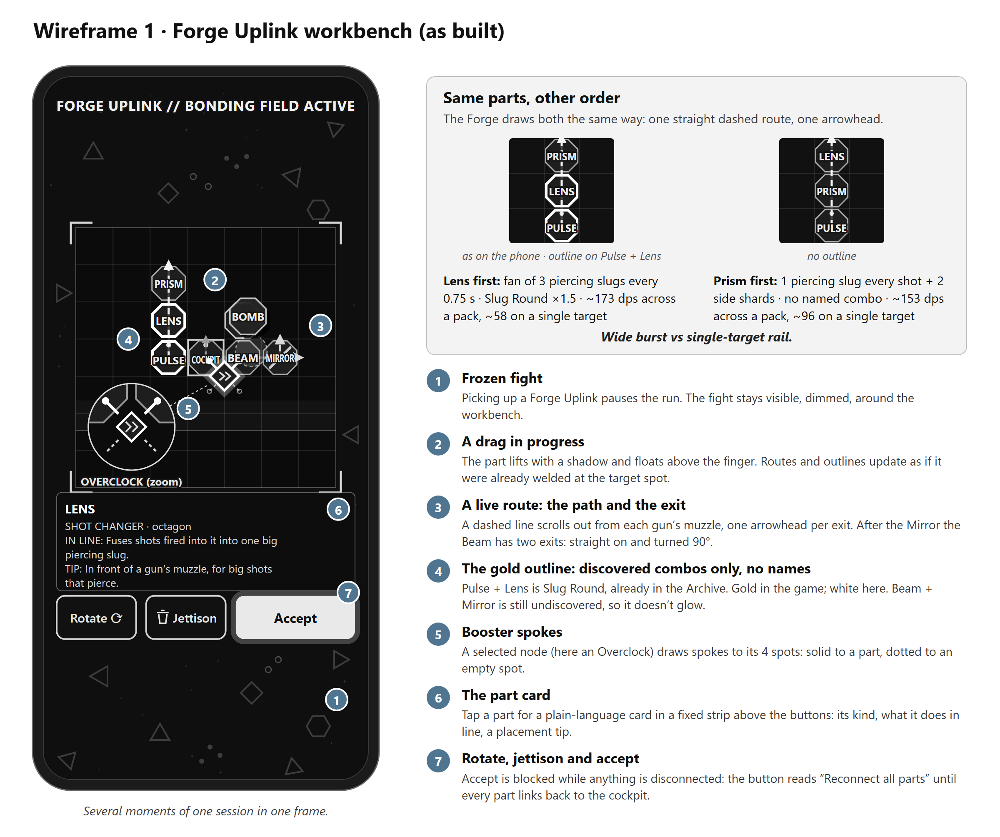
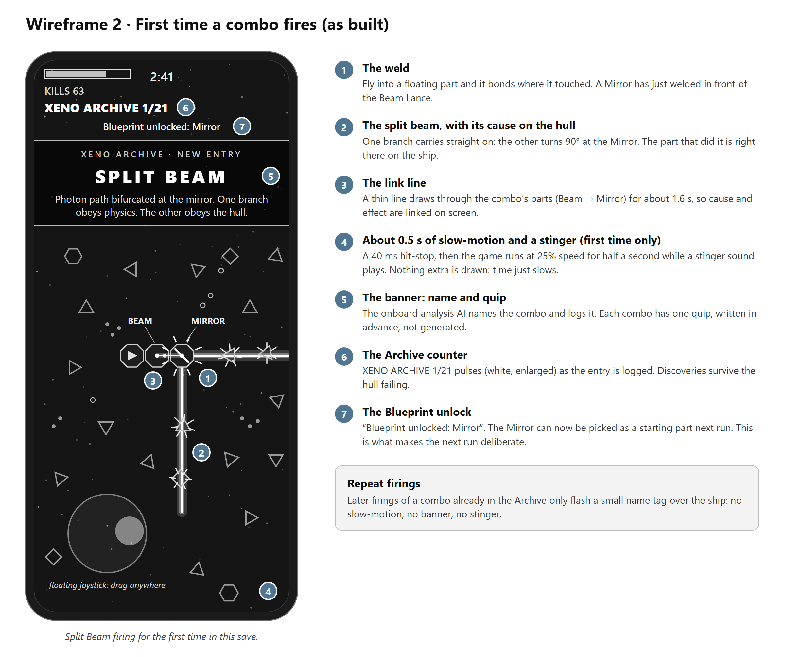

# The Forge Uplink: making build order matter in a survivor-like

**Play it:** https://rohan37kumar.github.io/MODULAR-src/ (the feature is built and playable in MODULAR, my Q1 prototype)

**Assumption:** Lila hasn't said which elements its survivor-like has, so this spec uses MODULAR's. A ship starts as a bare cockpit, enemies drop parts that weld on where they touch, Carrier mini-bosses arrive every 90 seconds, and the Xeno Archive collects the combos you find. Section 2 maps the feature onto level-up cards. Everything is built unless marked *next*.

## 1. Why this feature

I've played enough Vampire Survivors and Survivor.io to understand the punch they pack: one thumb, and a power curve you feel within a minute. My one issue is with the in-run upgrades. They never ask for calculation or effort. They don't work together in any way you have to think about, and the order you pick them in doesn't matter.

The only real input is which card you take, and evolutions are the payoff. In Vampire Survivors you need a fully levelled weapon plus its counterpart passive, then a treasure chest, usually from a boss after the 10-minute mark [1]. In Survivor.io you need a level-5 weapon plus its matching support skill [2]. Finding an evolution is a genuine wow. But it's a recipe. Once you've memorised it, every later run is a checklist, and new stages change the scenery, not your offence.

Noita, one of my favourite games, is the counter-example. A non-shuffle wand casts its spells from left to right [3], so the order of what you pick up *is* the build. That depth would drown an auto-attacker, though. Nobody can program a wand while dodging a horde on a phone.

Randomness alone isn't the fix: Vampire Survivors' level-up offers are already random. What's missing is **arrangement**. If each random part has to be placed, and the best place depends on what else arrived this run, then the same parts rarely make the same best build twice. The calculation is small (what goes first in a line, what sits next to what), but it can turn a gun into a different weapon.

Two decisions follow:
- **The calculation happens in a pause** (the Forge Uplink), because you can't do arithmetic under fire on a phone. Vampire Survivors already pauses at every level-up, so the genre accepts pauses. The Forge comes about once a minute.
- **Between pauses, parts attach themselves**, so flying stays one-thumb and the first combos happen by accident.

**Where it sits.**
- Backpack Battles makes adjacency the puzzle, but between rounds, and many of its combos are just bigger numbers.
- Captain Forever builds ships from salvage, but its parts only add to each other.
- Noita orders spells in a menu.

Mirrors on your own ship bending your own weapons is something my Q1 research didn't find in any shipped game [5].

## 2. How it fits the loop

You steer, and your weapons fire on their own. Destroyed enemies drop parts. Fly into one and it welds on wherever it touched, facing outward. That's how the first combos happen.

Every 60–90 seconds, and always when a Carrier dies, a **Forge Uplink** drops. Picking it up pauses the game for one free edit: move, rotate, jettison, accept. You can take the accident apart, work out why it happened, and build it on purpose.

The first time a named combo fires, it's announced and logged in the Xeno Archive, and its key part unlocks as a **Blueprint** start for the next run. A lucky accident becomes a plan.

**With level-up cards instead:** if Lila's game keeps card picks, a card offers a part rather than a stat. It auto-welds as above, and the Forge pause replaces every few level-up screens. The rules in section 3 don't care where a part came from.

## 3. The combo rules (the fully detailed section)

These are the rules the player calculates with, as the engine runs them [4].

### Parts: three jobs, two shapes

- **Guns** (octagons): Pulse Cannon, Beam Lance, Needle Turret, Cryo Turret, Saw, Bomb Pod and Arc Coil. The cockpit also has a small gun.
- **Shot changers** (octagons): Mirror, Lens, Prism and Hook. A Mimic octagon copies whichever part type it touches most.
- **Boosters** (small squares that sit in the gaps where octagons meet): Orbit Ring, Echo Coil, Thruster, Magnet, Bulwark Plate, Repair Node, Overclock and Relay.

The ship is a 7×7 grid of octagons with the cockpit at its centre, plus booster slots in the gaps. Every part is hitbox, so firepower costs size.

### Rule 1: touch

Every part gives one trait to everything it touches and receives theirs in return. An octagon touches its four edge neighbours and the boosters at its corners. A booster touches the octagons around it, up to four. A Lens makes its neighbours hit 20% harder. A Bomb Pod makes their shots explode on impact. A Cryo Turret makes them slow what they hit.

Traits are safe to collect by accident:
- The same trait received twice counts once.
- No trait makes a part worse.
- A trait with nothing to change on a shot type usually becomes a small boost instead (+15% damage or range).

### Rule 2: line of fire, in order

A gun's **line** is the unbroken run of parts in front of its muzzle. Each shot changer in that run transforms the shot **in the order the shot meets it**. Everything else in the line is transparent, so another gun in the way never blocks a shot.

- **Mirror** splits the shot. One branch carries straight on and one turns 90°; the mirror's orientation, `/` or `\`, picks the side. **Each branch carries 70%,** so a Mirror trades focus for coverage at a 40% net gain. Both branches keep routing through whatever lies beyond.
- **Lens** fuses. A bolt gun fires one big piercing slug every third trigger, at four times the damage. Three or more bolts arriving together fuse into one slug worth 1.33× their total. A beam becomes half as wide, twice as strong and 1.5× as long.
- **Prism** splits each shot into a 30° fan of three, at 60% each.
- **Hook:** where a shot through it lands, the other guns *touching* the Hook fire a payload at 60%, two at most per impact. Those guns keep firing normally too.

Guns aim in one of three ways:
- **Fixed** guns (Pulse, Beam) fire along their facing. You aim them by steering, with a ±25° assist.
- **Turrets** (Needle, Cryo, Saw, the cockpit) use "conduit, then aim". The shot travels its line inside the hull, changes at each shot changer, and auto-aims from wherever it exits, so a Mirror gives a turret two exits.
- **Emitters** (Bomb Pod, Arc Coil) need no aim and take touch traits only.

### Rule 3: boosters feed the parts around them

A booster sits in a gap, never in a line. One **Overclock** in the gap between four guns makes every timed gun among them fire three times as often at half damage; a beam gets 1.5× damage instead. **Orbit Ring** and **Echo Coil** give the routed guns they touch a line effect:
- With Orbit Ring, bolts circle the ship before striking, and a beam bends into a ring around it.
- With Echo Coil, every bolt fires twice (with a heat ring that can overheat), and a beam gets stronger and wider.

### Rule 4: a naming layer on top

The rules produce every effect. On top of them, the game recognises 21 patterns and names them: pairs of parts touching, a gun whose *first* shot changer is a particular part, runs of Mirrors, and a few larger multi-part patterns. A named combo gets:
- a first-time announcement;
- an Archive card;
- its key part as a Blueprint;
- a unique visual flourish;
- **1.5× strength**.

Some names contain others: Hall of Mirrors and Resonator replace Split Beam when they form. Six named combos have effects no rule produces, such as Resonator, where two back-to-back Mirrors of opposite orientation charge for three seconds, then fire out of both ends.

Unnamed results are intended. A Needle Turret behind a Lens fuses darts by the same rule as a Pulse Cannon, with no name and no card. The 1.5× bonus is there to make a discovery felt, but it tilts players toward the 21. Section 6 covers that cost.

### Same parts, different order

A Pulse Cannon alone fires 10-damage bolts, 4 a second: 40 damage per second. Put a Lens and a Prism in front of it, and the order decides what you're flying.

| | Pulse → Lens → Prism | Pulse → Prism → Lens |
|---|---|---|
| Output | Every 0.75 s, a 30° fan of **three** piercing slugs, 43.2 damage each | **Every shot** (4 a second), one piercing slug of 23.9 straight ahead, plus two side shards |
| Named combo | **Slug Round** (the first shot changer is a Lens): 1.5× | None (the first is the Prism) |
| Touch trait on the Pulse | +20% damage, from the Lens beside it | Two side shards per shot, from the Prism beside it |
| Damage across a pack | **~173** per second | **~153** per second |
| Damage on one target | **~58** (about one slug of the fan lands) | **~96** (every slug lands) |
| How it plays | Heavy, rhythmic volleys that clear a wide arc | A steady rail of slugs you aim by steering |

Neither order wins. One is a crowd-clearing fan, the other a boss-killing rail, and every Forge reopens the choice.

A Beam Lance does the same with a Mirror and a Lens:
- **Beam → Mirror → Lens** is **Split Beam**: one long, thin lance straight ahead (72.5 damage per second, range up from 220 to 330) plus a plain side beam (36.2).
- **Beam → Lens → Mirror** has no name and gives two equal focused beams at 90° (50.4 each). Here the 1.5× naming bonus is what puts Split Beam ahead; without it, the unnamed order would deal more.
- Add a second Mirror of the same orientation and you get **Hall of Mirrors**: three beams from one gun, one straight ahead and two side by side towards one flank.

Transparency makes combos too. In **Pulse → Bomb Pod → Lens**, the Bomb Pod in the line blocks nothing. It *touches* the Pulse, so the Pulse's bolts take its Warhead trait and explode on impact, and its own bombs now burst into 12 bolts: **Cluster Shell**. The Lens beyond still makes Slug Round. The Pulse ends up firing one 60-damage, piercing, exploding slug every third shot.

One booster can rewire four guns. An Overclock in the gap between a Pulse, a Needle, a Cryo and the cockpit triples all four fire rates, and Overclock touching Cryo is the named **Flash Freeze**.

### Why order works here when it fails in a menu

In a menu, order would be invisible bookkeeping. Here the line is physical: you can see which part a shot meets first, and the Forge draws every route. Noita's shuffle wands "can lead to... not reliably applying modifiers" [3], hiding cause and effect. MODULAR has no shuffle, and every named combo is linked on screen the first time it fires.

> **Curation note: where the AI text was wrong**
> AI drafted much of this design's text. Each line is a wrong claim and how it was caught.
> - "Half the shot continues straight" (my AI-drafted Q1 design doc). In the code, each Mirror branch carries 70%, a net gain of 40%. Found by reading the router.
> - "These two orders do about the same damage" (Claude, while planning). The engine said 173 against 96, and that went into the first draft. It was wrong too: it missed the side shards the game adds at runtime, and single targets. A second review found ~173 against ~153 across a pack, flipping to ~58 against ~96 on one target. That flip is now the headline example.
> - "Hall of Mirrors: three beams in different directions." Two Mirrors of the same orientation turn the same way, so two of the beams run side by side. Found by a reviewer reading the mirror rule.
> - "A gold SLUG ROUND label over the parts" (the first spec for Wireframe 1). The Forge has shown no combo names since a playtest; it draws a plain gold outline. Caught by a review against the code, so the wireframe shows the build as it is.

## 4. The Forge Uplink session

**When it drops:** every 60–90 seconds, plus one from every Carrier. That's far rarer than Vampire Survivors' level-up screens.

**What opens:** the game pauses. A hologram workbench appears over the frozen, dimmed fight: a glowing blueprint grid, a slow scan line, and the header "FORGE UPLINK // BONDING FIELD ACTIVE". The first time, a one-line tutorial shows.

**What you can do:**
- **Drag** a part to move it. On a phone, the dragged part floats above your finger.
- **Rotate** it: R, right-click or the ⟳ button. A Mirror flips between `/` and `\`.
- **Jettison** it: X, or drag it to the bin. This is a real decision too: every part is hitbox, so cutting a weak part shrinks the target.
- **Accept** with Enter or the button.

**What it shows you:**
- **Live routes.** Every gun's line is drawn as a dashed line in the gun's colour, flowing out from the muzzle and ending in an arrowhead at each exit (a Mirror makes two). Routes update while you drag. They show the path, not the result. You learn the result by flying it.
- **Part cards.** Tap or hover a part and a strip above the buttons says, in plain words, what kind it is (GUN, SHOT CHANGER, BOOSTER or COPYCAT), what it does alone, what it gives its neighbours, what it does in a line, and where it works best. A selected booster draws spokes to the spots around it.
- **Known combos.** Parts forming a combo you've *already discovered* get a gold outline. Undiscovered combos never glow, so there are no hints.

**One rule:** every octagon must link back to the cockpit edge to edge, and every booster must touch a linked octagon. Anything cut off turns red, Accept is blocked, and "Reconnect all parts" shows.

## 5. The payoff in flight

The first time a named combo fires in a save:
- the game drops into about half a second of slow motion, with a stinger sound;
- a thin line links the parts that made it;
- a banner names the combo, with a line from the ship's analysis AI;
- the Archive counter ticks up;
- the combo's key part unlocks as a Blueprint start, if it isn't unlocked already.

After that, the combo only flashes a small name tag when it fires.

## 6. Risks, and what I'd measure

- **The Forge is a chore.** Measure: the share of Forge sessions with a move or rotate, not just Accept. Target: at least half after the first run; below that, test auto-arrange.
- **The pause breaks the flow.** Target: a median Forge session of 20 seconds or less, against about a minute of flying between Forges.
- **Phone precision.** Dragging parts on a 7×7 grid on a screen about 390 points wide is the obvious mobile risk. Measure mis-drops (a part placed, then moved straight back); the levers are bigger touch targets and zoom.
- **The naming bonus narrows play.** The 1.5× bonus can outweigh the rules, as the Beam example shows. If discoveries pile up on the same few named builds and unnamed experiments stop, I'd cut it towards 1.2×, or reward the first time an unnamed stack fires.
- **Combos fire, but nobody can say why.** *Next:* if players can't predict outcomes, the first fix is an output preview at each exit (a fan, a slug, a beam's width), before any hints.
- **Discovery as the hook.** Target: at least 3 combos discovered on day 1, and players who reach 3 should retain better than those who don't. If they don't, the Archive isn't the hook I think it is.

---

## Sources

1. Vampire Survivors Wiki, "Evolution". https://vampire.survivors.wiki/w/Evolution
2. BlueStacks, "Survivor.io skills evolution guide". https://www.bluestacks.com/blog/game-guides/survivor-io/sio-skills-evolution-guide-en.html
3. Noita Wiki, "Wands" (cast order and shuffle). https://noita.wiki.gg/wiki/Wands
4. MODULAR source, the combo engine: grid, traits, line routing, shot compiler, recogniser. https://github.com/rohan37kumar/MODULAR-src/tree/main/q1-game/src/core
5. My Q1 writeup (money, metagame, reference games and the originality search). https://github.com/rohan37kumar/MODULAR-src/blob/main/docs/q1/writeup.md

## How AI was used

- **Mine:** the insight and the feature. My own notes for this answer are kept verbatim in `docs/q3/user-input.md`. Every design decision behind the feature is logged with a date in my Q1 design documents.
- **Claude** (Anthropic's Claude Opus, in Claude Code):
  - built MODULAR's code to plans I approved;
  - asked the questions that shaped this spec, one decision at a time;
  - drafted the text from my notes and the Q1 design documents;
  - built both wireframes.
- **Checks:** the numbers in section 3 come from the game's combo engine and runtime code. A separate AI reviewer then recomputed them by hand against the code. The curation note lists what that checking caught, including an error the first check missed.
- **The final text:** I reviewed and edited it.
